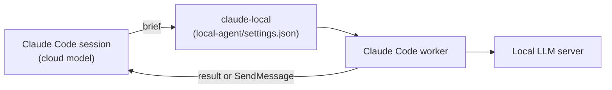

# claude-local-agent

A Claude Code skill (`local-agent`) that runs local-LLM agents alongside cloud models. The cloud session plans and reviews; scoped work goes to a second Claude Code process that talks to your local model.

Windows, Linux and macOS.

## How it works



`claude-local` is `claude` with different settings: it skips the user-level `settings.json` and loads `~/.claude/local-agent/settings.json`. All arguments are passed through.

The built-in Agent tool cannot use the local model, so a worker is always a separate process. It can run one-shot, or as a background session that you can message and attach to.

## Requirements

- Claude Code on `PATH`.
- A local server that speaks the Anthropic API.
- Linux and macOS: `jq`, `node` or `python3`, to read the settings file.

## Install

Run one line in your own terminal. It downloads the repository, runs setup and removes the download. No clone or git is needed.

Windows (PowerShell):

```powershell
irm https://raw.githubusercontent.com/EduardSmilyi/claude-local-agent/main/scripts/install.ps1 | iex
```

Linux and macOS:

```bash
curl -fsSL https://raw.githubusercontent.com/EduardSmilyi/claude-local-agent/main/scripts/install.sh | bash
```

This runs code straight from the `main` branch. Read the scripts first if you do not trust the source.

To pass options:

```powershell
& ([scriptblock]::Create((irm https://raw.githubusercontent.com/EduardSmilyi/claude-local-agent/main/scripts/install.ps1))) -Configure
```

```bash
curl -fsSL https://raw.githubusercontent.com/EduardSmilyi/claude-local-agent/main/scripts/install.sh | bash -s -- --configure
```

From a clone, run `powershell -ExecutionPolicy Bypass -File scripts/setup.ps1` or `bash scripts/setup.sh` instead.

Setup installs three things:

| What | Where |
| :--- | :--- |
| `claude-local` | The folder that holds `claude`, so it is already on `PATH` |
| `local-agent` skill | `~/.claude/skills/local-agent/` |
| Settings | `~/.claude/local-agent/settings.json` |

It then asks for the server URL, token (hidden), model, context window and max output. `CLAUDE_CONFIG_DIR` replaces `~/.claude` if you set it. `PATH` is never changed.

| Option (Windows / Linux, macOS) | Effect |
| :--- | :--- |
| `-Configure` / `--configure` | Ask for the settings again |
| `-InstallDir <dir>` / `--install-dir <dir>` | Put `claude-local` somewhere else, for example when the folder of `claude` is not writable |

To update, run the install line again (or pull and run setup). Replaced files are kept with a `.bak` suffix.

### Upgrading from the `local-worker` plugin

Remove the plugin, then run setup. Setup moves `~/.claude/settings-local.json` to the new location.

```powershell
claude plugin uninstall local-worker@local-worker-tools
```

```powershell
claude plugin marketplace remove local-worker-tools
```

## Configuration

The setup dialog covers the usual values. You can also edit the `env` block of the settings file.

| Variable | Meaning |
| :--- | :--- |
| `ANTHROPIC_BASE_URL` | Address of your local server |
| `ANTHROPIC_AUTH_TOKEN` | Server token |
| `ANTHROPIC_MODEL`, `ANTHROPIC_SMALL_FAST_MODEL`, `ANTHROPIC_DEFAULT_*_MODEL` | Model name served locally |
| `CLAUDE_CODE_MAX_CONTEXT_TOKENS`, `CLAUDE_CODE_MAX_OUTPUT_TOKENS` | Limits that match your model |

Set `CLAUDE_LOCAL_SETTINGS` to use a different settings file.

Never put a real token in this repository. `settings.template.json` is a template only.

## Usage

Name the local agent in your request, or type `/local-agent`.

| Request | Uses the local model |
| :--- | :--- |
| `/local-agent find every TODO in src` | Yes, explicit |
| "Use local-agent to add tests for the parser" | Yes, explicit |
| "Run `claude-local` to summarize this module" | Yes, explicit |
| "Have the local model rename these methods" | Yes, implicit |
| "Offload this boilerplate to my local LLM" | Yes, implicit |
| "Delegate this investigation locally" | Yes, implicit |
| "Use a subagent to search the repo" | No, built-in agent |
| "Add a web worker for image resizing" | No |
| "Run the tests locally" | No |

Claude decides from the skill description, so implicit requests are less certain than explicit ones.

You can also run a worker yourself:

```powershell
claude-local -p "List the C# files that define a service." --allowedTools "Read,Grep,Glob"
```

The [skill](skills/local-agent/SKILL.md) describes permissions, background sessions and review.

## Contents

| Path | Purpose |
| :--- | :--- |
| `skills/local-agent` | The skill: when and how to delegate |
| `scripts/claude-local.ps1` | The wrapper for Windows |
| `scripts/claude-local` | The wrapper for Linux and macOS |
| `scripts/setup.ps1`, `scripts/setup.sh` | Setup |
| `scripts/install.ps1`, `scripts/install.sh` | Download and run setup |
| `settings.template.json` | Settings template |

## Limitations

- Nothing technically restricts a worker's edits to the files in its brief. Review the diff.
- Workers get no shell access with the documented flags, so they cannot run tests or builds.
- Background sessions cannot use auto mode through a local server. Set `--permission-mode`.
- On Windows, `claude-local` is a PowerShell script, so it is not available from `cmd`.

## Troubleshooting

See the table in the [skill](skills/local-agent/SKILL.md#troubleshooting).

## License

[MIT](LICENSE)
